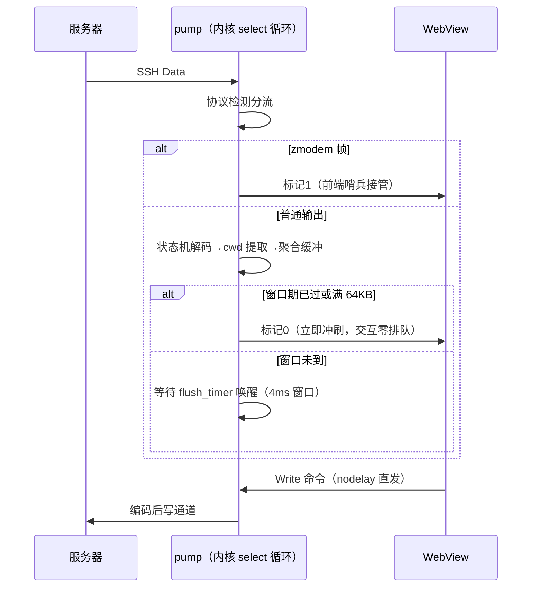
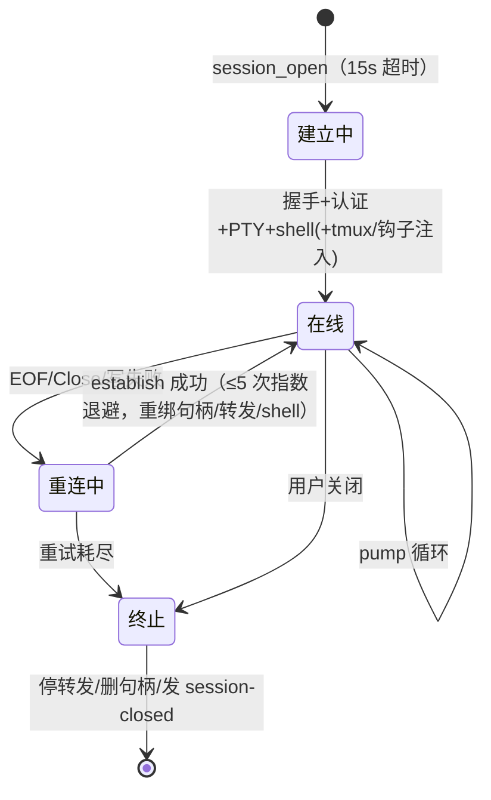

# 架构详解

本文面向维护者，记录 s-shell 的内部结构、关键设计决策与已踩过的坑。产品级说明见 README。

## 技术栈

| 层 | 选型 |
|---|---|
| 外壳 | Tauri 2（WKWebView / WebView2 / WebKitGTK） |
| SSH | russh 0.65（ring 后端，关 aws-lc-rs 避免 generic-array 版本冲突） |
| SFTP | russh-sftp 3（File 支持 AsyncRead/Write/Seek，续传依赖 Seek） |
| 前端 | React 19 + TypeScript + Vite 6 + Tailwind 4 + Zustand 5 |
| 终端 | xterm.js 5.5（WebGL→Canvas 降级）+ zmodem.js |
| 存储 | rusqlite（bundled SQLite）+ keyring 3（ring 做 AES-256-GCM） |

## 模块图

```mermaid
flowchart TB
    subgraph UI["React 前端"]
        TV["TerminalView（xterm+zmodem 哨兵+输入采样）"]
        SP["SftpPanel"] SV["SnippetsView"] KV["KnownHostsView"] AD["AiDrawer"]
    end
    subgraph K["Rust 内核"]
        SES["ssh/session.rs 会话泵"]
        FWD["forward.rs 转发"] SFTP["sftp.rs"] REC["record.rs"] MCP["mcp.rs"] SYNC["sync.rs"] AI["ai.rs"] LOG["log.rs"] MK["masker.rs"] COD["codec.rs"] DET["detect.rs"] ST["store.rs"] VLT["vault.rs"] TMX["tmux.rs"] CPT["ssh/compat.rs"]
    end
    TV -->|"invoke 会话命令"| SES
    SES -->|"Channel 裸字节(带模式标)"| TV
    SES --> COD
    SES --> DET
    SES --> REC
    SES --> ST
    SES --> FWD
    SES --> LOG
```

## 会话数据流（核心路径）



### 关键设计决策

1. **聚合必须配定时器分支**：`tokio::select!` 只有事件臂时，4ms 窗口到期不会唤醒循环——单字符回显会一直压到下一个事件才上屏（已踩坑：表现为「打第二个字才显示第一个字」）。现以 `flush_timer`（sleep_until deadline / pending）作为独立臂。
2. **交互优先冲刷**：距上次冲刷 ≥4ms 或缓冲 ≥64KB 立即冲刷；洪泛才批处理。孤立击键回显零排队。
3. **zmodem 打标旁路**：普通输出带标记 0 直写 xterm（Uint8Array 快路径）；检测到 `**\x18`（ZRQINIT）后带标记 1 透传给前端哨兵，绝不过编码与聚合。zmodem.js 哨兵回调键名是 **sender**（非 to_sender），接收文件走 `offer.on("input") + accept()`。
4. **UTF-8 混合解码**：完整块走 SIMD 校验直通；跨块半字符才进状态机。曾因逐块 lossy 把 TCP 分块切碎的中文变 U+FFFD（基准测试暴露）。
5. **TCP_NODELAY 必须显式设置**：tokio 默认关闭 nodelay，击键小包被 Nagle+延迟 ACK 拖出数百毫秒抖动（Termius 对比实验定址）。直连/SOCKS5/HTTP 三条路径均显式开启。
6. **跳板链**：外层→目标逐级 `channel_open_direct_tcpip` + `connect_stream`，每级句柄入 keepalive 向量防 drop 断链；每级独立指纹固定与认证。
7. **回显 RTT 采样**：写出时间戳 → 下批输出到达差值，10 样本出中位/最大日志。曾据此定位「打字慢」为缺失定时器而非网络（最小值 3ms 证明链路快）。

## 会话生命周期



## 存储结构（SQLite）

| 表 | 用途 |
|---|---|
| hosts | 主机（含编码/兼容/代理/跳板/压缩/外壳集成/更新时间；ALTER 加列均做 NULL 回填+读取容忍） |
| known_hosts | 指纹固定（host+port 主键） |
| forwards | 转发规则（local/remote/dynamic） |
| snippets | 命令片段 |
| mcp_requests | 外部工具审批队列（GUI 每 2s 轮询，120s 超时拒） |
| settings | 键值（AI 端点/WebDAV/开关） |

迁移原则：新列一律 `ensure_column` + `UPDATE 回填 NULL` + 读取层 Option 容忍（曾因 NULL 崩列表查询）。

## 凭据双模式

- 探测：Linux 无 Secret Service → 主密码模式；macOS/Windows → 钥匙串
- 主密码库：文件 = salt(16) + nonce(12) + AES-256-GCM(密文+tag)；Argon2id 派生；解锁幂等（同口令重复解锁 Ok）
- 已知坑：aes-gcm 0.10 的 generic-array 版本与全树冲突，改用 ring

## AI 管道

终端上下文 → strip_ansi（OSC/CSI/单字符三正则）→ masker（5 类规则）→ 6000 字符截尾 → 用户勾选排除 → chat（OpenAI 兼容 /chat/completions）→ 答案内 bash 块可一键写入终端（写入前过 check_command 危险规则，命中弹确认）。

自动摘要：输出爆发 >200KB 且停顿 ≥2s → 取尾部 50KB → summarize（独立系统提示词）→ `ai-summary` 事件 → AiDrawer 展示。设置 `ai_autosummary=1` 开启。

## MCP 服务端

入口：`main()` 解析 argv，`mcp` 子命令走独立 tokio runtime 的 stdio 循环，不初始化 WebView。

- 行分隔 JSON-RPC 2.0；initialize/tools/list/tools/call/ping
- run_command / upload_file 受审批闸门：写 `mcp_requests` 行 → GUI 每 2s 轮询弹窗 → approved/denied；设置 `mcp_approve_commands=0` 可关闸
- 凭据接口对 MCP 不可达（工具面无凭据操作）
- 审批行 1 天自动清理

## 同步（快照合并）

push：hosts 全量 + settings 全量 → WebDAV `s-shell-config.json`（凭据永不入库）。pull：下载 → `merge_snapshot`——同一性为主机名，更新时间新者胜，设置 INSERT OR REPLACE。已知取舍：改名视为新主机；增量 oplog 未做。

## 端口转发

- local：TcpListener accept → direct-tcpip → copy_bidirectional
- dynamic：最小 SOCKS5（CONNECT、无认证，IPv4/域名/IPv6）
- remote：`tcpip_forward` + Handler `server_channel_open_forwarded_tcpip` 接受 → 连本地目标；停止走 `cancel_tcpip_forward`
- 会话关闭经 `app.try_state::<ForwardManager>()` 统一回收；规则启停支持在线重应用

## 回显采样与性能验收

- `echo-rtt`：写时间戳 → 下批输出到达，10 样本出中位/最大，附「写出等待」（data_bytes 耗时）区分 russh 内部排队与网络
- `fit` 计数：10 秒窗口统计自适应重排次数（滚动条风暴取证）
- 启动自测：8MB 通道吞吐 + 30 次 invoke 往返 + 300 块突发回放（内核跨度 vs 前端跨度差 = 通道投递延迟）
- 基准：`性能_百MB解码聚合吞吐`（ASCII 载荷保证字节数无损可比；多字节跨块替换语义由单测覆盖）

## 设计令牌（P0-P3 落地）

`styles.css` `:root` 持有形状/排印/动效令牌，颜色令牌由 `theme.ts` 按主题注入 `:root`——组件层禁止手写十六进制色与临时字号。

| 令牌组 | 值 |
|---|---|
| 圆角三档 | 卡片 `--radius-card:12px`、控件 `--radius-control:8px`、内嵌 6px |
| 字号四阶 | 辅助 `--fs-aux:12px`、正文 `--fs-body:13px`、强调 `--fs-emph:15px`、标题 `--fs-title:18px` |
| 动效 | `--dur-fast:150ms`（按钮/边框）、`--dur-panel:200ms`（面板滑入/弹窗） |

- 语义类：`sinput/sbtn/slabel/smodal/sside/ssection/stitle` 全部消费令牌
- 主题准入：新主题正文级对比度必须 ≥4.5:1（计算脚本已建，solarized-light 曾 3.78 已修）
- 动效：面板 `sshell-slide-in` 200ms、弹窗 `sshell-pop` 150ms、`prefers-reduced-motion` 全局降级
- 主题切换：界面 CSS 变量即时生效；已开终端经 `sshell-theme` 事件实时换配色，无需重开


## 功能扩展（0.0.2）

- **隧道中心**：`forward_list_all/forward_toggle/forward_active_rules/check_port_free`；`ForwardManager::active_rule_ids` 供状态灯，启停时对在线会话整组重绑
- **会话日志**：`SessionCommand::LogStart/LogStop` 挂 `SessionState.log_file`，`flush_agg` 同步写盘（session-logs/ 目录）
- **触发器**：`triggers` 表 → 会话启动时按主机过滤编译正则 → pump 解码后扫描，命中回包走 `data_bytes`，冷却 2 秒
- **片段升级**：snippets 表加 send_enter/auto_run/host_id 列；自动执行在前端 `onSessionReady` 按 host 过滤依序写入
- **主机分组**：hosts 加 group_name 列（ensure_column + 回填），前端按组分区渲染
- **传输队列**：sftp.rs `TRANSFERS` OnceLock 登记表，`run_transfer_task` 用 `tokio::select!` 与取消位竞争，`transfer_list/transfer_cancel` 命令
- **密钥管理器**：ssh-keygen 生成 ed25519 到 ~/.ssh/s-shell-keys/，部署经 `exec_command` 追加 authorized_keys（grep -qxF 防重复）
- **命令块**：xterm onData 回车分块（键入字符剔除转义序列累积），`lib/blocks.ts` 注册表 + BlocksDrawer 跳转/复制

## 已踩坑清单（防回归）

1. encoding_rs `decode_to_string` 以 String 容量为上限且不扩容——必须先 `max_utf8_buffer_length` 预留
2. zmodem.js Sentry 键名 `sender`、角色方法 `get_session_role()`、接收走 input/complete 事件
3. russh 0.65：`keepalive_max` 为 usize；`Channel` 在 crate 根；`PublicKeyOrCertificate::PublicKey { key, .. }`；authenticate 系列需 `&mut handle`
4. keyring 3 判空用 `Error::NoEntry`，删除用 `delete_credential()`
5. Tauri async 命令的 `State` 必须写 `State<'_, T>` 且返回 Result
6. ALTER 加列后旧行为 NULL：回填 + Option 读取双保险
